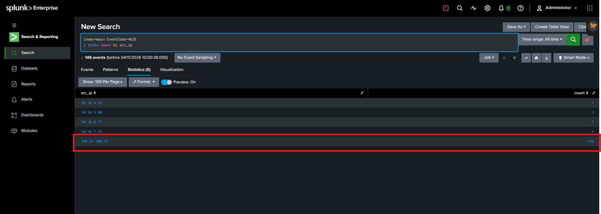
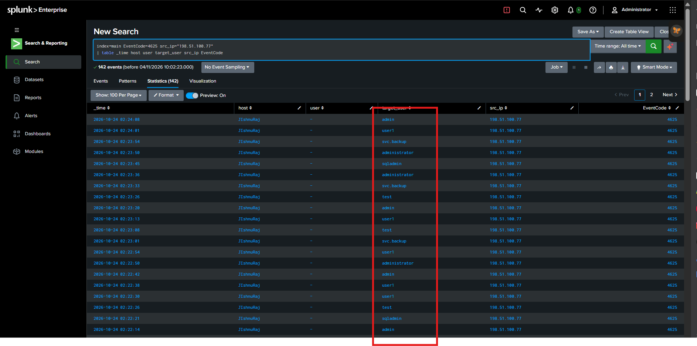
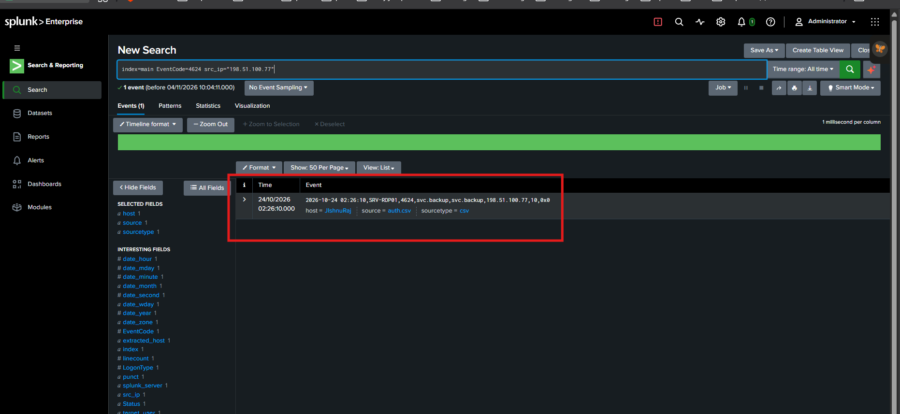
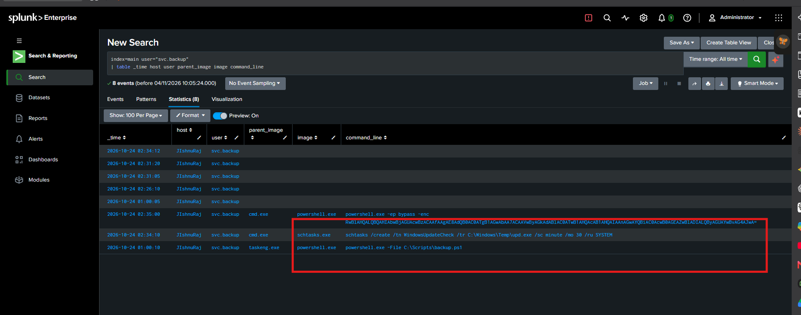
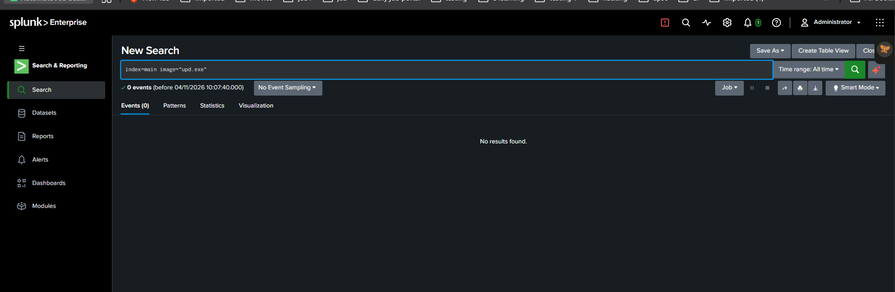

# SOC L1 Incident Investigation: Failed Logons Followed by Successful RDP Login

**Portfolio case study | Splunk | Simulated training/lab logs | SOC L1**

## Project overview
This project documents an L1 investigation of a High-severity SIEM alert: more than 100 failed logons within 30 minutes, followed by a successful authentication.

**L1 disposition:** Escalated to L2 for further investigation.  
**Incident status:** Pending further investigation; compromise is not confirmed.

> **Lab-data note:** `198.51.100.77` is in a documentation/example IP range. Present this as a training investigation, not a real-world attribution.

## Case details

| Field | Value |
|---|---|
| Alert | Many failed logons, then a success |
| Severity | High |
| Event date | 24 October 2026 |
| Account | `svc.backup` |
| Source IP | `198.51.100.77` |
| Successful logon type | 10 — Remote Interactive / RDP |
| Failed logons | 142 |
| L1 outcome | Suspicious activity; escalate to L2 |

## Objectives
1. Validate the alert using authentication logs.
2. Identify source IP and targeted account names.
3. Check for a successful login from the same source.
4. Review available endpoint events for the account.
5. Document evidence, timeline, limitations, and escalation recommendation.

## Environment
- SIEM: Splunk
- Index: `main`
- Windows Event IDs: 4625 (failed logon), 4624 (successful logon)
- Additional endpoint process and scheduled-task events
- Data: uploaded lab CSV files

## Investigation

### 1. Identify source IPs for failed logons

```spl
index=main EventCode=4625
| stats count by src_ip
```

**Finding:** `198.51.100.77` generated 142 failed logons. Four other source IPs generated one each.



### 2. Review failed logons from the source

```spl
index=main EventCode=4625 src_ip="198.51.100.77"
| table _time host user target_user src_ip EventCode
```

**Finding:** Attempts occurred approximately 02:10:03–02:19:55 on 24 October 2026. Target names included `svc.backup`, `admin`, `backup`, `user1`, `test`, `administrator`, and `sqladmin`.

**L1 interpretation:** The volume and multiple targeted account names are consistent with brute-force activity. Password spraying is only a possibility; attempted passwords are not available in these events.



### 3. Check for successful authentication

```spl
index=main EventCode=4624 src_ip="198.51.100.77"
```

**Finding:** One successful logon was found at 02:26:10 for `svc.backup` from the same source IP. Logon Type 10 indicates Remote Interactive / RDP.

**Data-quality note:** The raw event identifies host `SRV-RDP01`, while the parsed Splunk `host` field showed `JIshnuRaj`. This discrepancy requires validation.

**L1 interpretation:** The successful RDP login after repeated failures is suspicious. The available logs do not prove that the login was unauthorised.



### 4. Review endpoint activity

```spl
index=main user="svc.backup"
| table _time host user parent_image image command_line
```

**Finding:** A scheduled task creation command was observed:

```text
schtasks /create /tn WindowsUpdateCheck /tr C:\Windows\Temp\upd.exe /sc minute /mo 30 /ru SYSTEM
```

The task was created at approximately 02:34:10, configured to run every 30 minutes, and specified the SYSTEM account.

A separate encoded PowerShell command decoded to:

```powershell
Get-Process | Out-Null; Write-Output 'lab-stage2-recon'
```

This writes a lab marker to output; it does not by itself establish malicious reconnaissance.

**L1 interpretation:** The task configuration is suspicious because it references an executable in a temporary directory and is configured to run as SYSTEM. Task creation is observed; execution of `upd.exe` is not established.



### 5. Search for evidence of `upd.exe` execution

```spl
index=main "upd.exe"
```

```spl
index=main image="upd.exe"
```

**Finding:** The available searches showed the task-creation reference but no process-execution event for `upd.exe`.

**Limitation:** No execution event was found in the uploaded dataset. This does not prove that the executable never ran.



## Evidence summary

| ID | Observation | Evidence status |
|---|---|---|
| E-01 | 142 failed logons from `198.51.100.77` | Observed |
| E-02 | Multiple account names targeted | Observed |
| E-03 | Successful `svc.backup` logon from same IP | Observed |
| E-04 | Logon Type 10 | Supports RDP / Remote Interactive |
| E-05 | Scheduled task references `C:\Windows\Temp\upd.exe`, runs as SYSTEM every 30 minutes | Task creation observed; suspicious context |
| E-06 | No `upd.exe` process event found in uploaded logs | Search result only |
| E-07 | Parsed host differs from raw event hostname | Data-quality discrepancy |

## Timeline

| Time, 24 Oct 2026 | Event | Significance |
|---|---|---|
| 02:10:03–02:19:55 | 142 failed logons from `198.51.100.77` | High-volume authentication failures |
| 02:26:10 | Successful `svc.backup` login from same IP; Type 10 | Suspicious RDP login after failures |
| 02:34:10 | `WindowsUpdateCheck` task created | Suspicious task configuration |
| 02:35:00 | Encoded PowerShell command observed | Recorded for escalation; decoded content is a lab marker |

Confirm timezone and timestamp parsing before comparing with other systems.

## MITRE ATT&CK mapping

| Technique | Name | Reason | Confidence |
|---|---|---|---|
| T1110 | Brute Force | High volume of failed logons | Behaviour consistent |
| T1021.001 | Remote Desktop Protocol | Successful event has Logon Type 10 | Supported by event field |
| T1053.005 | Scheduled Task/Job | Task creation observed | Supported |
| T1110.003 | Password Spraying | Multiple account names targeted | Possible, not confirmed |

Do not claim T1078 (Valid Accounts) as confirmed malicious use unless unauthorised use is established. Successful authentication alone does not prove compromise.

## L1 assessment and disposition

**Assessment: Suspicious activity — further investigation required.**

The logs show 142 failed logons from one source, followed by a successful RDP login to `svc.backup` from the same source. Endpoint logs then show creation of a recurring scheduled task referencing an executable in `C:\Windows\Temp` and configured to run as SYSTEM.

These observations justify escalation. However, the available dataset does not confirm that the login was unauthorised, that `upd.exe` executed, or that the host was compromised.

**L1 disposition:** Escalated to L2.  
**Ticket status:** Pending L2 investigation.  
**L1 investigation:** Complete.

## L2 handoff recommendations (not actions performed by L1)
- Validate whether the `svc.backup` RDP login was expected and authorised.
- Confirm the affected host identity and resolve the host-field discrepancy.
- Validate the scheduled task and determine whether the referenced executable exists or ran.
- Review relevant endpoint and authentication telemetry for additional context.

No containment or remediation action is claimed in this project.

## Sample ticket closure note

> L1 investigation completed. Identified 142 failed authentication attempts from `198.51.100.77`, followed by a successful RDP login to `svc.backup` from the same source IP. Additional endpoint review identified creation of a recurring scheduled task referencing `C:\Windows\Temp\upd.exe` with SYSTEM privileges.
>
> The activity is considered suspicious and may indicate unauthorised access. However, execution of the referenced executable and account compromise have not been confirmed from the available logs.
>
> Findings and supporting evidence have been documented. Escalating to SOC L2 for further investigation.
>
> **L1 disposition:** Escalated | **Ticket status:** Pending L2 investigation

## Limitations
- This is a lab investigation using the uploaded dataset, not a verified production incident.
- The logs do not establish whether the successful login was authorised.
- The logs do not confirm execution of `upd.exe`.
- The parsed host field is inconsistent with a hostname in a raw event.
- The available data does not establish impact, successful persistence, command-and-control, or data exfiltration.
- No L2 forensic analysis, containment, or remediation was performed.

## Skills demonstrated
Splunk SPL, Windows authentication event review, basic endpoint process review, evidence documentation, timeline creation, MITRE ATT&CK mapping, L1 triage, and escalation writing.

## Screenshot checklist
Save genuine Splunk screenshots in `screenshots/` with these exact names:
1. `01-failed-logons-by-source.png`
2. `02-failed-logon-details.png`
3. `03-successful-rdp-logon.png`
4. `04-endpoint-process-review.png`
5. `05-upd-exe-search.png`

Crop screenshots so the SPL and relevant result rows are readable. Hide unrelated personal information, tokens, and account details.

## Publish to GitHub
1. Create a public repository named `soc-l1-brute-force-investigation`.
2. Upload this folder and its contents.
3. Add your screenshots to `screenshots/` using the exact filenames above.
4. Confirm the images render in the README.
5. Add the repository URL to your resume or portfolio.

**Portfolio integrity:** Present this as a hands-on lab investigation. Do not describe the IP as a real attacker, claim a confirmed breach, or claim to have completed L2 investigation.
