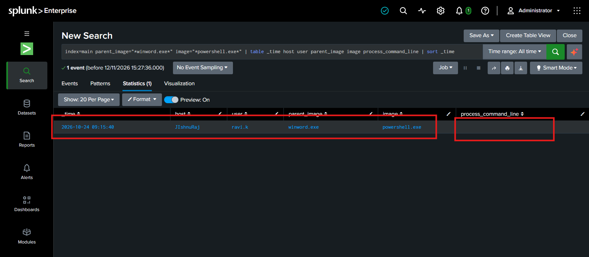
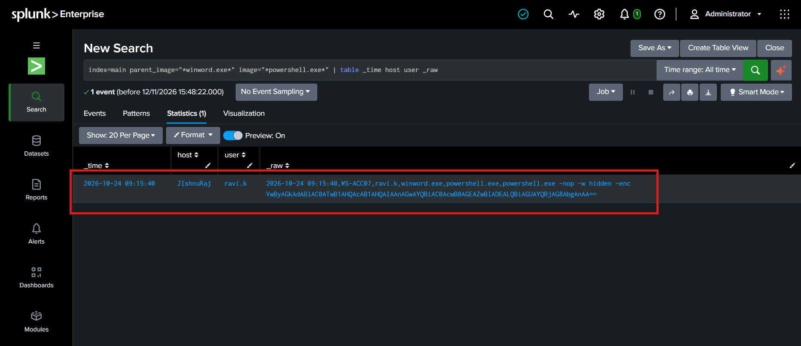
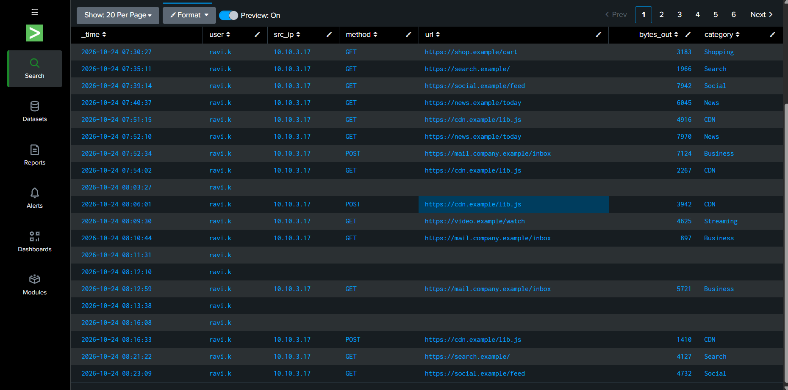
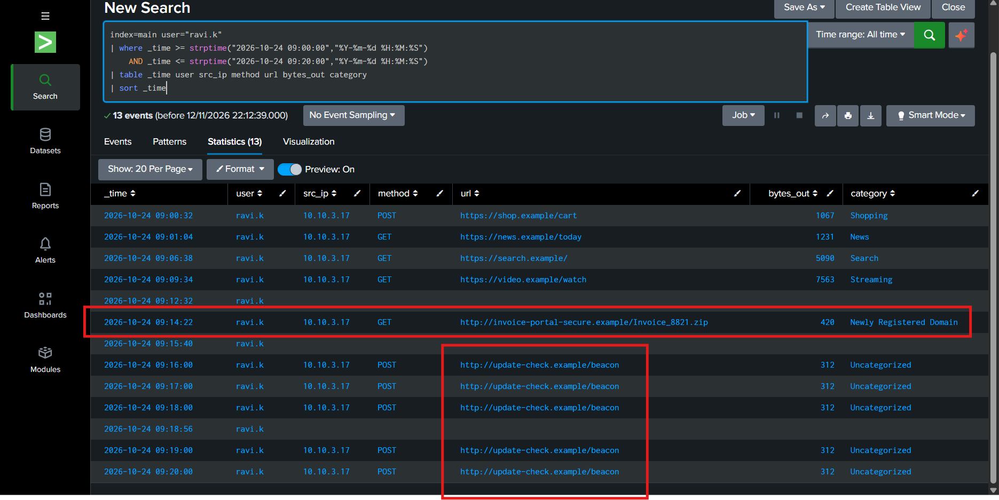
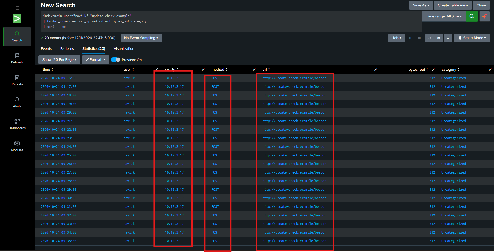
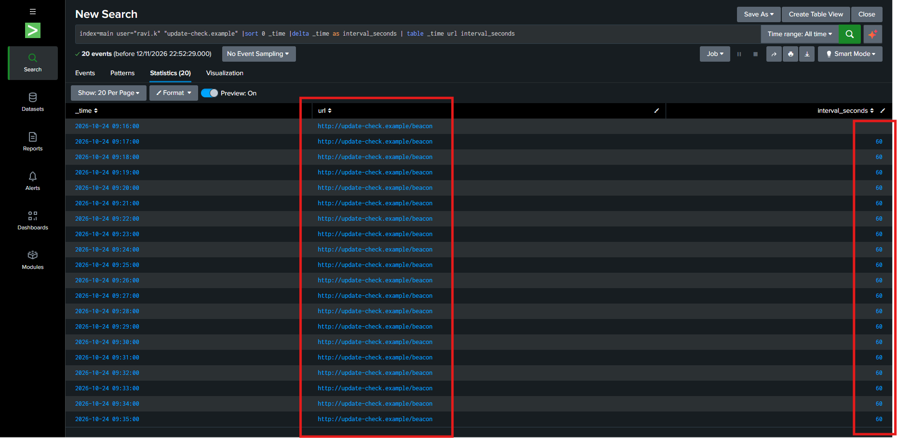

# SOC L1 Investigation – Suspicious PowerShell Launched by Microsoft Word

**Project Type:** Simulated SOC Lab Investigation  
**SIEM Tool:** Splunk Enterprise  
**Role:** SOC Analyst – Level 1 (L1)  
**Alert Severity:** High (lab-provided severity)  
**Investigation Date:** 24 October 2026  
**Investigation Status:** Suspicious activity identified – escalated for L2 validation

---

## 1. Project Overview

This project demonstrates a Security Operations Center (SOC) Level 1 investigation using Splunk.

The investigation started with an alert indicating that Microsoft Word (`winword.exe`) launched PowerShell (`powershell.exe`).

The objective was to investigate the process relationship, inspect the PowerShell command, correlate proxy activity, identify repeated external network requests, and document the findings for escalation.

The investigation uses simulated endpoint and proxy log datasets.

## 2. Investigation Objectives

- Identify the affected host and user.
- Identify the parent and child processes.
- Retrieve and inspect the complete PowerShell command line.
- Decode the Base64-encoded PowerShell command.
- Investigate proxy activity before PowerShell execution.
- Identify network communication after PowerShell execution.
- Calculate the interval between repeated network requests.
- Map observed behavior to relevant MITRE ATT&CK techniques.
- Prepare an L1 investigation report and escalation recommendation.

## 3. Lab Environment

| Component | Details |
|---|---|
| SIEM | Splunk Enterprise |
| Index | `main` |
| Endpoint dataset | `endpoint.csv` |
| Proxy dataset | Proxy log CSV |
| Firewall dataset | `firewall.csv` |
| Authentication dataset | Windows authentication logs |
| Investigation date | 24 October 2026 |

All available datasets were uploaded to Splunk under `index=main`.

## 4. Alert Details

| Field | Value |
|---|---|
| Alert | PowerShell launched by Microsoft Office |
| Severity | High |
| Event time | 09:15:40 |
| User | `ravi.k` |
| Parent process | `winword.exe` |
| Child process | `powershell.exe` |
| Host | See host-validation note in the investigation report |
| Source IP in proxy logs | `10.10.3.17` |

## 5. Executive Summary

The endpoint logs recorded Microsoft Word launching PowerShell under user `ravi.k` at 09:15:40 on 24 October 2026.

The raw process event contained the following command:

```powershell
powershell.exe -nop -w hidden -enc VwByAGkAdABlAC0ATwB1AHQAcAB1AHQAIAAnAGwAYQBiAC0AcwB0AGEAZwBlADEALQBiAGUAYwBvAG4AJwA=
```

The encoded command decoded to:

```powershell
Write-Output 'lab-stage1-beacon'
```

Proxy logs recorded a GET request to:

`http://invoice-portal-secure.example/Invoice_8821.zip`

This request occurred at 09:14:22, approximately 78 seconds before the PowerShell event.

Following the PowerShell event, repeated HTTP POST requests were recorded to:

`http://update-check.example/beacon`

The requests occurred between 09:16:00 and 09:35:00. Splunk's `delta` command showed a consistent 60-second interval between consecutive requests.

The regular communication pattern is consistent with automated beaconing and warrants further investigation.

However, the available evidence does not independently prove malware infection, successful ZIP execution, or confirmed command-and-control communication.

**L1 conclusion:** Suspicious activity requiring escalation to the L2 security team.

## 6. Investigation Timeline

| Time | Activity |
|---|---|
| 09:14:22 | GET request for `Invoice_8821.zip` |
| 09:15:40 | Microsoft Word launched PowerShell |
| 09:16:00 | First POST request to beacon endpoint |
| 09:17:00 | Second POST request |
| 09:18:00 | Third POST request |
| 09:19:00–09:35:00 | Repeated POST requests at 60-second intervals |

## 7. Investigation Process

### Phase 1 – Process Identification

The endpoint logs were searched for PowerShell processes launched by Microsoft Word.

Identified process relationship:

- Parent process: `winword.exe`
- Child process: `powershell.exe`
- User: `ravi.k`
- Time: 09:15:40

Microsoft Word launching PowerShell is unusual in many normal office workflows and requires investigation.

### Phase 2 – Encoded PowerShell Command

The raw endpoint event contained the PowerShell flags:

- `-nop` – prevents PowerShell from loading its profile.
- `-w hidden` – requests a hidden PowerShell window.
- `-enc` – indicates an encoded command.

The Base64 command was decoded using UTF-16LE encoding.

Decoded command:

```powershell
Write-Output 'lab-stage1-beacon'
```

This command writes a text string to the PowerShell output stream. It does not, by itself, prove that malware was downloaded or executed.

### Phase 3 – Proxy Investigation

The proxy logs were reviewed around the PowerShell event.

At 09:14:22, the following request was recorded:

`http://invoice-portal-secure.example/Invoice_8821.zip`

The request was categorized as `Newly Registered Domain`.

The request occurred approximately 78 seconds before the PowerShell execution.

The proxy record does not independently confirm that the ZIP file was successfully downloaded, opened or executed.

### Phase 4 – Network Activity Investigation

After the PowerShell event, repeated HTTP POST requests were observed.

Destination:

`http://update-check.example/beacon`

Observed characteristics:

- HTTP method: POST
- Source IP: `10.10.3.17`
- User: `ravi.k`
- Recorded `bytes_out`: 312
- Category: Uncategorized
- First observed request: 09:16:00
- Last observed request: 09:35:00

### Phase 5 – Beaconing Analysis

Splunk's `delta` command was used to calculate the time difference between consecutive requests.

The result showed a consistent interval of 60 seconds.

This behavior is consistent with periodic beaconing, which may be associated with command-and-control communication.

However, periodic communication can also occur in legitimate applications. Further investigation is required before confirming C2 activity.

## 8. MITRE ATT&CK Mapping

| Technique ID | Technique | Investigation relevance |
|---|---|---|
| T1059.001 | PowerShell | PowerShell execution was observed. |
| T1071.001 | Web Protocols | Repeated HTTP POST communication was observed. |
| T1105 | Ingress Tool Transfer | A ZIP URL request was observed before the process event; actual transfer and execution are unconfirmed. |
| T1204.002 | Malicious File | Possible document-related execution scenario; user execution is not confirmed. |

These are behavior mappings and investigation hypotheses, not confirmation that every technique was successfully used by an attacker.

## 9. L1 Analyst Findings

The investigation identified the following suspicious indicators:

1. Microsoft Word launched PowerShell.
2. PowerShell used hidden-window and encoded-command options.
3. A ZIP URL was accessed shortly before PowerShell execution.
4. Repeated HTTP POST requests were sent to an uncategorized domain.
5. The POST requests occurred at regular 60-second intervals.

These indicators justify escalation for further investigation.

## 10. Recommended L2 Actions

- Verify whether the ZIP file exists on the endpoint.
- Collect the ZIP file's SHA-256 hash.
- Review the complete endpoint process tree.
- Identify which process generated the repeated POST requests.
- Investigate the destination domain using approved threat-intelligence sources.
- Review DNS, firewall and endpoint network telemetry.
- Check for suspicious persistence mechanisms and additional processes.
- Follow the organization's incident-response procedure for containment decisions.

L1 should not independently isolate the endpoint or block the destination unless authorized by organizational policy.

## 11. Investigation Limitations

- The ZIP file hash was not available in the supplied evidence.
- The proxy request does not prove successful file execution.
- The decoded PowerShell command only writes a string.
- Repeated POST requests do not independently prove C2.
- No confirmed data exfiltration was established.
- The host value differs between the initial extracted-field result and the raw event. It must be verified before publishing a single host as definitive.

## 12. Screenshot Evidence

The screenshots below document the Splunk searches and findings.

### 01 – Process Identification



### 02 – Raw Event and Encoded Command



### 03 – Proxy Activity Timeline



### 04 – ZIP Request



### 05 – Repeated Network Activity



### 06 – Beacon Interval Analysis



## 13. Skills Demonstrated

- Splunk Enterprise
- Basic SPL queries
- Endpoint log analysis
- Process relationship investigation
- PowerShell command-line analysis
- Base64 decoding
- Proxy log investigation
- Event correlation and timeline creation
- Basic beaconing detection
- MITRE ATT&CK mapping
- Incident documentation
- SOC L1 escalation procedures

## 14. Final Conclusion

This project demonstrates a basic SOC L1 investigation workflow using Splunk.

The investigation identified suspicious Office-to-PowerShell execution, a nearby ZIP URL request, and repeated HTTP POST requests at regular 60-second intervals.

The evidence was documented and mapped to relevant MITRE ATT&CK techniques. Due to the limitations of the available logs, the activity was classified as suspicious and recommended for L2 validation rather than declared a confirmed malware infection.

**Project outcome:** L1 investigation completed; L2 escalation recommended.
